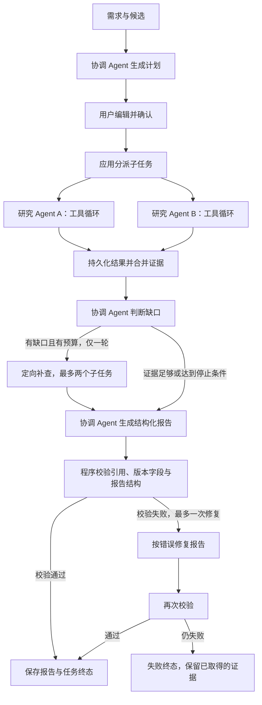

# 技术调研 Agent V1：产品、Multi-Agent 与验收方案

日期：2026-11-14。状态：设计方案，尚未实施或验收。

当前主题状态（2026-11-16）：用户仍在比较多个求职主题，详见[主题比较与企业知识评测](./2026-11-16-求职主题比较与企业知识评测.md)。本页保留当时的技术调研候选设计，不作为当前已确认开工指令。

2026-11-16 补充：[功能与开源选型](./2026-11-16-Agent功能与开源选型.md)明确完整功能场景、近期维护的开源参考、算法复用和逐项评测证据；完整 V1 纳入跨任务项目记忆，不再将长期记忆全部后置。基础任务、证据与恢复契约继续沿用本页。

用户已确定重启 Agent Lab，作为独立的 AI 应用 / Agent 开发求职项目；选题为面向研发团队的技术调研与选型 Agent，并希望第一版考虑 Multi-Agent。本页将该方向收敛为可实现的第一版。具体默认限额是设计起点，尚无性能与质量实测支持。

## 1. 第一版决定

**用户给出软件项目需求和 1～3 个候选组件（典型任务为两个候选对比），系统调查官方资料，按需求比较，并交付带原文证据、版本说明和未知项的中文报告。**

- 产品对象：需要调查软件组件、服务端框架或开发工具的开发者。
- 主模式：一个协调 Agent，加最多两个同时运行的研究 Agent 实例。研究 Agent 复用同一实现，分别接收不同子任务和独立上下文；无需三个不同模型。
- 决策方式：协调 Agent 拆解、分派、合并、判断证据缺口和写报告；研究 Agent 在限定工具与预算内自主搜索、阅读和整理事实。
- 工程控制：计划确认、任务持久化、全局预算、来源校验、取消与恢复由应用代码实施。
- 必交付：研究工作台、结构化报告与 Markdown 导出、可恢复的任务、执行记录、单 / 多 Agent 对照。
- 第一版定位：本机单用户作品，可录制端到端演示。公网多人服务需要另外设计认证与运行隔离。

心屿展示完整业务产品；Agent Lab 展示多步任务执行、上下文与证据管理、恢复及效果评测。项目实际效果和个人贡献以后续代码、运行记录与实验为准。

## 2. 用户任务与范围

### 2.1 代表任务

> 我有一个 Python / FastAPI 项目，要做后台任务。比较指定的两个候选，关注任务持久化、失败重试、定时执行、部署依赖和维护成本。必须区分服务重启与任务恢复的实际语义，说明调查版本，并列出需要自行验证的地方。

这里的候选只作为任务输入，不在设计文档中预先给出技术结论。默认不让 Agent 自动推荐任意数量的新产品。

### 2.2 输入与输出

输入包括：问题、简短项目背景、候选名称（最多 3 个）、比较维度（最多 6 项，区分硬要求与偏好）、可选官方资料 URL（最多 8 个）。缺少版本时，计划中提出“调查截至日期与目标版本”的约定，允许用户确认或调整。

首批支持资料：公开 HTML、Markdown、GitHub README / Release。第一版针对用户指定候选进行调查，暂不接入 PDF/OCR、登录网站、代码仓库执行或自动安装组件。无法读取的页面留下失败原因；搜索摘要仅用于发现来源，不直接充当最终证据。

报告包括：需求与假设、候选 / 版本、逐维度对比、结论依据、限制与冲突、未知项、条件化建议、来源。调查时间、文档适用版本与页面获取时间分别记录，不能混为同一字段。

**第一版验证的是资料调查与证据整理，不能把文档写着“支持”当成已经实测该组件。** 尚需实验的能力明确列入报告。

### 2.3 用户流程

1. 创建任务，填写需求与候选。
2. 看到结构化调查计划：范围、假设、子任务、限额；缺少决定性条件时先补充。
3. 编辑并确认计划后，开始调查。计划最多重做一次，调用计入同一任务预算。
4. 工作台显示各子任务的状态、搜索 / 阅读动作、来源、已覆盖维度和缺口。
5. 获取报告，点击结论可查看对应原文快照；下载 Markdown。
6. 可以取消任务；进程中断后查看已保存进度并显式恢复。

关闭页面只断开观察，不取消后台任务。任务取消通过独立操作完成。

## 3. Multi-Agent 设计

### 3.1 为什么在第一版加入

不同候选通常可以独立调查，适合分开上下文并并行获取资料。协调 Agent 负责统一比较维度，避免每个研究 Agent 自己改变题目。

这是一项待验证的设计选择：多 Agent 可能减少墙钟时间，也可能增加重复搜索、协调成本和不一致。第一版必须有单 Agent 基线，不能把角色数当作效果。

### 3.2 两种职责，最多三个活跃 Agent 实例

| 职责 | 输入 | 自主决策 | 输出与限制 |
| --- | --- | --- | --- |
| 协调 Agent | 用户需求、确认计划、研究结果、预算余量 | 拆成 2～3 个可独立调查的子任务；判断缺口；安排一次补查；组织报告 | 结构化计划 / 缺口 / 报告；不能改执行限额、创建任意角色或直接改资料 |
| 研究 Agent | 一个子任务、相同的比较维度、允许来源、局部预算 | 选择查询、读取哪个页面、是否继续跟进链接、何时提交结果 | 事实候选、证据引用、冲突与未解决项；不能调用其他 Agent 或写最终报告 |

研究 Agent 实例使用独立消息历史。它们共享只读需求与经服务端确认的来源缓存，输出先分开保存，再由协调流程合并，不并发修改同一份长对话。

每个子任务有稳定的 task ID 与检查点命名空间，恢复时沿用；同一研究子图被并行调用时不能误用同一个 thread / namespace 合并历史。具体子图持久化配置须由当前安装版本的隔离与重启测试确认。

计划、汇总和写作由同一协调职责在不同阶段完成；无需额外拆出 Planner、Writer、Reviewer 三个常驻 Agent。确定性的引用检查是程序逻辑，不计作一个 Agent。

### 3.3 分派与补查

- 初始子任务按候选分配，每个候选覆盖全部确认维度；最多 3 个子任务，最多 2 个并行。
- 只有一个候选或任务无法独立拆分时，运行一个研究实例，工作台如实显示。
- 研究结果必须保留事实与证据，不能只返回一段无出处的摘要。
- 协调 Agent 合并后输出明确缺口，例如“候选 B 的当前版本是否保留失败任务记录”；最多新增 2 个补查子任务，只补查一轮。
- 预算不足、查不到或证据冲突仍未解决时，以未知项结束调查并交付受限报告，不无限反思。

检索工具与模型的选择路径由 Agent 决定；分派数量、补查轮数、限额和校验规则由应用决定。

## 4. 工具、证据与上下文

### 4.1 最小工具集

| 工具 | 输入 / 返回 | 关键约束 |
| --- | --- | --- |
| `search_sources` | 查询与允许域名；返回标题、URL、发现摘要 | 候选 URL 仅用于发现；搜索调用计预算 |
| `read_source` | URL 或已有来源 ID；返回正文片段与来源 / 快照 ID | 缓存命中返回原快照；正文有大小上限；可按位置继续读取 |
| `save_finding` | 维度、事实候选、适用版本、证据片段 ID、未知 / 冲突说明 | 服务端核对片段属于本任务；重复事实幂等写入；不允许任意路径写文件 |

工具输出错误需有稳定分类，例如页面不可达、正文不可提取、来源受限、参数错误、预算耗尽。可纠正的错误回传给研究 Agent 选择下一步，原始异常与堆栈不直接作为正文证据。

初接一个搜索提供商（拟用 Tavily，具体客户端与账户限制在接入时核对），网页读取使用 HTTPX 与单一正文提取实现。模型沿用项目已有兼容接口。离线资料适配与在线资料适配均实现同一资料获取 Interface；V1 不同时接入多个商业搜索服务。

### 4.2 来源与报告契约

- 服务端为实际取得的资料创建来源 ID、正文哈希、获取时间、最终 URL 和不可变快照；模型不能自行注册“已经读过”的来源。
- 模型提交的摘录必须定位到快照内的原文；截断资料仅能支持实际交付给模型的片段。
- 搜索标题 / 摘要、模型先验、其他 Agent 的无证据结论不能变成原文来源。
- 先保存结构化报告，再由程序渲染 Markdown 和链接；非法来源 ID 或缺失必要证据不能通过结构校验。
- 每个候选 × 维度都要有一行。事实结果可为 `supported`、`unknown`、`conflict`；适配结果另记 `meets`、`does_not_meet`、`unknown`，避免把事实存在等同于满足需求。
- 检查出处存在、摘录匹配和结构完整，不等于证明结论被原文支持。语义支持、冲突解释和推荐理由需要模型评审与人工校准；展示评审方法和状态。
- 硬要求缺证据时，建议必须附条件；全部候选有明确证据不满足时，可以合理得出“没有合适候选”。

### 4.3 上下文策略

研究 Agent 常驻上下文只包括需求摘要、当前子任务、已存证据索引、缺口和最近工具交互。正文放快照，按位置读取；已存事实和历史工具输出可被索引替代。

协调 Agent 接收结构化事实、缺口与证据索引，写报告前按需读取关键片段。第一版先验证有界工具输出与外置笔记，不将自动摘要压缩作为启动门槛；完整版本补齐上下文预算与长任务验证。跨任务项目事实 / 用户偏好的使用、更新和删除纳入完整 V1，语义记忆做现成实现对照，详见[功能与开源选型](./2026-11-16-Agent功能与开源选型.md)。自动学习 Skill 不作为第一版要求。

外部网页作为不可信资料处理，不能改变任务、预算和工具权限。读取端仅允许 HTTP(S) 公网资料，检查重定向目标与网络地址，阻止本机 / 私网和本地文件读取；网页里的指令不能触发代码执行。

## 5. 状态、预算与失败处理

### 5.1 任务状态与阶段分开

状态：`queued`、`running`、`waiting_confirmation`、`interrupted`、`succeeded`、`partial`、`failed`、`cancelled`。

阶段：`planning`、`researching`、`checking`、`synthesizing`。等待确认保留 `planning` 阶段。

- 创建后排队规划；生成计划后 `waiting_confirmation`。
- 确认后排队调查；正常流程为 researching → checking → synthesizing。
- `succeeded`：报告与证据已落盘，程序校验通过，关键硬要求已有可追溯结论；不等于所有事实已由独立真人验证。
- `partial`：能交付合法报告，但存在硬要求缺证、未解决冲突或最终失败的研究子任务。查询正常但未找到资料可以是 partial。
- `failed`：模型 / 资料基础设施整体不可用，或报告修复后仍不合法，无法交付合格产物；保留证据与失败记录。
- `interrupted`：进程重启后发现未完成的执行；不会在启动时悄悄重发所有模型请求。
- `cancelled`：停止调度并取消可取消的本地请求，保存已有结果；不承诺供应商已经停止计算或不计费。

### 5.2 第一版默认限额（待真实任务校准）

| 项目 | 初始设计值 |
| --- | --- |
| 同时执行的研究任务 | 1 个；可排队；同任务最多 2 个研究 Agent 并行 |
| 候选 / 维度 | 最多 3 个 / 6 项 |
| 模型 HTTP 尝试总数 | 每任务最多 24 次，包括重试、计划重做、补查和报告修复 |
| 初始研究子任务 | 每个最多 4 次模型调用；最后一次用于提交结果 |
| 补查 | 最多 1 轮、2 个子任务，每个最多 3 次模型调用 |
| 搜索 / 页面获取 | 全任务最多 12 次搜索、16 次实际页面获取；缓存命中另计命中数 |
| 单次模型输出 | 上限拟为 2,048 tokens，具体请求参数由模型适配核对 |
| 网络请求 | 模型单次最多 45 秒；页面 / 搜索单次最多 15 秒 |
| 执行截止 | 用户确认后 10 分钟；规划阶段另有 2 分钟期限，等待用户不计入执行截止 |

局部限额只是上限，不保证能全部用满，24 次全局尝试优先；协调流程与所有研究实例共用计数。自动 HTTP 重试全任务最多 2 次，仍消耗总数，只处理可重试的瞬态读取 / 模型错误。预算在实际请求前通过短事务预留，防止并行越限；恢复不重置调用预算与截止时间。

调查开始前至少为最终报告保留一次模型调用与对应输出额度，研究和补查不能占用；没有补查额度时直接汇总现有材料。报告修复也要检查剩余额度；最终写作本身失败仍可导致 failed，保留证据供查看。

Token、耗时与可估算费用单独记录。缺 usage 标未知；供应商未报告的用量不记为 0。调用数 / 输出上限控制与 Token 观测分开，不能将估算输入 Token 宣称为精确计费上限。第一版不承诺具体每任务价格。

### 5.3 失败行为

| 情况 | 第一版行为 |
| --- | --- |
| 一个研究 Agent 失败 | 先保存成功分支；剩余预算内做有限补查，否则 partial |
| 取得同一页面 | 单进程合并同时读取并复用同任务快照，保留各自引用关系 |
| 资料互相矛盾 | 标记来源、时间和版本；可补查一次；不能强行取多数 |
| 研究 Agent 提前称完成 | 必须提交结构化结果及缺口；协调阶段仍检查维度覆盖 |
| 报告引用伪造 / 越任务 | 校验失败并有限修复；不作为正常结果交付 |
| 研究 / 搜索额度耗尽 | 停止调查，使用预留写作额度生成受限报告；不绕过总上限或已到的截止时间 |
| 浏览器刷新 / SSE 断开 | 后台继续，重新读取快照并接续事件 |
| 进程中断 | 标 interrupted；显式恢复仅重做未完成操作，复用已落盘分支 |

## 6. 持久化与恢复

V1 使用本机 SQLite 与工作区资料文件。研究数据、事件和框架检查点位于新的研究专用存储，不复用聊天消息 / 记忆表来冒充任务存储。

应用记录是业务事实来源：

| 记录 | 关键字段 / 用途 |
| --- | --- |
| Run | 需求、模式、状态 / 阶段、计划版本、限额与消耗、截止时间、活动执行标识 |
| Subtask | 候选、调查目标、状态、研究结果、错误与重试信息 |
| Source / Snapshot | URL、来源类型、版本信息、获取时间、正文哈希与快照位置 |
| Finding | 候选 / 维度、事实候选、证据位置、适用版本、未知与冲突 |
| Artifact | 结构化报告、Markdown、修订号和校验结果 |
| Operation | 操作键、输入哈希、预留预算、发起 / 完成状态、响应或错误、usage |
| Event | 按任务递增的序号、时间、子任务、事件类型、可展示负载 |

Graph checkpoint 保存阶段与任务 / 结果引用，用于恢复调度。**有 checkpoint 不等于所有外部操作恰好执行一次。** 原文快照、Operation 结果和分支结果必须可先独立持久化；恢复节点先查询已完成操作，成功结果可复用。事件与应用状态在同一短事务提交；网络等待放在事务之外。

V1 使用一个任务执行器，启动时把上次未结束的活动任务标为 interrupted。恢复请求通过事务竞争活动执行标识，同一任务最多一个执行器。已完成的子任务不重新执行；图输出遗漏时依据已保存结果重新归并。

模型请求已经发出、但进程在保存响应前退出时，结果与计费可能未知。该次预算保留为已消耗 / 待核对，显式恢复可在剩余预算内重新调用，记录重复尝试的关系；不宣称模型请求 exactly-once。来源与报告使用确定操作键避免重复创建。

已过截止时间或预算不足的任务只能查看和导出已有产物；需要重新调查时新建任务，保留旧记录。恢复能力需通过真正的新进程验收，旧的“同进程重开 SQLite 连接”实验不能替代。

## 7. HTTP、事件与界面

### 7.1 最小 HTTP Interface

| 请求 | 职责 |
| --- | --- |
| `POST /research/runs` | 创建并排队规划；接受创建幂等键，返回任务 ID |
| `GET /research/runs/{id}` | 读取任务、计划、子任务、已有报告和事件游标 |
| `POST /research/runs/{id}/revise-plan` | 仅等待确认时可按 expected plan revision 重做计划，最多一次 |
| `POST /research/runs/{id}/confirm` | 校验计划版本与调整字段，确认后排队调查 |
| `POST /research/runs/{id}/resume` | 恢复 interrupted 的任务，不重置预算 |
| `POST /research/runs/{id}/cancel` | 幂等取消；终态不重新调度 |
| `GET /research/runs/{id}/events` | SSE 读取已持久化事件，支持 Last-Event-ID 接续 |
| `GET /research/runs/{id}/sources/{source_id}` | 查看属于此任务的资料快照 / 引用片段 |
| `GET /research/runs/{id}/report.md` | 导出已通过结构校验的报告及明确的 partial 标记 |

创建幂等键与请求体哈希绑定；相同键不同请求返回冲突。计划确认使用 expected plan revision；重复确认返回现有状态，过期版本或运行后改计划返回冲突。V1 本机单用户，不接受不可信 user_id 作为权限凭证。

### 7.2 事件契约

每条事件包含任务 ID、单调事件序号、时间、阶段、可选子任务 ID 与公开负载。类型包括状态变化、计划就绪、子任务开始 / 完成、工具开始 / 完成、证据新增、预算更新、报告就绪和任务终态。事件持久化先于对浏览器发送，客户端按序号去重。

刷新后先加载任务快照，再从快照的游标后订阅，避免丢事件。V1 保留完整任务事件，不先引入清理策略。终态事件仅在产物和状态已保存后产生；网络连接结束不能代替任务成功。

公开展示计划摘要、动作目的、工具参数摘要、观测结果与证据，不展示隐藏思维链、密钥或完整敏感请求。正文先整份保存后交付，第一版的流式能力集中在任务进度事件。

### 7.3 工作台

采用 Vue3 + TypeScript 单页工作台：上方需求与计划确认，中间子任务 / 工具轨迹，右侧或下方报告和原文证据。提供任务列表、刷新恢复、取消、Markdown 下载。

页面应能演示“两个子任务同时工作”“有一项未知”“一个分支失败后恢复”，不只展示最终长文。以组件与状态反馈为主，首版不做复杂编辑器、图形工作流搭建器或多人协作。

## 8. 代码落点与已有能力

以 `app/research/` 容纳研究 Module，通过少量入口承担规划、确认、执行、查看与恢复；HTTP 层不直接拼接各 Agent 的 prompt 和消息历史。

建议内部划分：`models.py`（任务 / 证据契约）、`engine.py`（调度与恢复）、`agents.py`（协调与研究循环）、`tools.py`（研究工具）、`sources.py`（资料获取 Adapter）、`store.py`（存储与操作去重）、`report.py`（校验 / 渲染）、`api.py`（请求 / 事件）、`worker.py`（任务执行器）。实际文件拆分按实现复杂度调整，不为文件数增加转发层。

LangGraph 编排父流程，研究循环使用独立消息状态的子图。使用当前锁定依赖验证所需行为，再决定是否补直接依赖声明；本方案不要求升级框架。离线与在线资料获取是已知的两种 Adapter；不预建多框架、多模型、多数据库插件系统。

| 现有位置 | 可参考或复用 | 尚需新增 / 验证 |
| --- | --- | --- |
| `app/services/llm.py` | 原始兼容协议、错误分类、LLMResult / tool-call 解析 | 研究消息输入、输出与超时限额、可共享客户端、操作记录；原函数当前固定 message / history 结构 |
| `app/services/agent.py` | 工具循环、执行前预算、部分失败记录思路 | 研究工具、错误反馈、局部 / 全局预算、分支结果 |
| `app/services/langgraph_agent.py` | 图节点、条件边、结果契约 | 当前只是计算器图，不能直接作为研究图 |
| `app/services/langgraph_checkpoint.py` | SQLite saver 生命周期 | 研究专用数据与真正跨进程恢复、并行分支保存 |
| `app/services/rag_citations.py` | 来源白名单思路 | 当前仅检查引用 ID，不验证语义；新建快照 / Finding / 报告契约 |
| `app/services/sse.py` 与静态消费者 | SSE 编码 / 消费经验 | 当前只有 delta/done/error；研究事件另建契约及持久化重放 |
| `playground/evaluation_summary.py` | 分母、未知用量、已复核覆盖的统计方法 | 研究任务与单 / 多 Agent 对比 |

旧聊天、记忆与机制实验保留为历史参考。修改共用模型底层时跑相关旧回归；新研究入口不依赖匿名聊天归属、自动 Memory 提取或旧向量索引才能运行。

## 9. 验收与单 / 多 Agent 对照

### 9.1 两种证据分开

- 工程验收：预设外部 HTTP / 模型响应，真实运行本地工具、图、数据库、工作台和进程恢复，证明契约与异常行为。
- 模型效果：固定版本资料、真实模型、自定义标准与逐题结果，证明限定任务上的事实、覆盖与成本表现。离线全绿不能代替。

### 9.2 任务集与比较方法

首批拟定 20 个资料任务：6 个候选对比、4 个跨文档能力调查、4 个新旧版本冲突、4 个资料不足、2 个无需并行的单候选任务。先按任务和对应资料划分 8 个开发题、12 个保留题，避免同一题改写后跨组；保留题不用于调 prompt。这个规模是起始计划，不是可靠性的统计证明。

先保存 HTML / Markdown 正文及哈希、适用版本、问题和参考事实，形成冻结资料适配。冻结资料评价推理与证据处理；在线任务另做端到端抽验，不能混为实时检索性能。

比较两种模式：

1. `single`：一个 Agent 持有全部调查上下文，负责搜索、整理与报告；用户计划确认、工具、资料与报告检查契约一致。
2. `multi`：协调 Agent + 独立研究实例；同一任务全局预算，最多两个研究实例同时工作。

使用相同模型、资料快照、调用 / 输出上限和评分标准，记录实际 Token；同预算上限不等于同实际 Token。保留题每种模式至少重复两次；在线与批量付费评测在后续配置运行预算后分批执行，本次只制定方案。

多 Agent 的结果只有在质量 / 覆盖改善，或质量接近但墙钟时间降低，且成本增量可以解释时，才能称有收益。若实耗 Token 差异大，另做成本接近的对照再谈架构贡献。结果不佳时保留单 Agent 默认路径，并在报告中解释原因。

第一版效果交付门槛是保留题完整执行记录、已复核关键事实与引用、逐题成功 / 不足 / 失败说明，以及成本和耗时统计；未执行项列出，不能以省略失败样本的方式提交“通过率”。不预设无证据的 90% 准确率或固定提速倍数。真实评测中若出现伪造来源、引用错配或关键版本混淆，作为阻断问题修复并回归；其他残余问题随质量报告明确披露。

### 9.3 指标

| 维度 | 第一版口径 |
| --- | --- |
| 关键事实正确性 | 按题目参考事实检查，保留否定、版本和条件，不只做关键词命中 |
| 引用支持 | 来源 ID / 摘录定位程序检查；结论是否得到原文支持单独复核 |
| 需求覆盖 | 所有要求均有结论或明确未知；区分“覆盖一行”和“已有可靠答案” |
| 冲突与资料不足 | 应识别冲突 / 不足的题是否正确处理，未知不能当成错误事实 |
| 任务完成与恢复 | 状态和合法产物一致；恢复后复用已完成分支；取消不再调度 |
| 成本与延迟 | 模型 / 搜索实际次数、已知 Token、缺失用量、估算费用与完整耗时 |

程序、模型与真人评审记录身份和方法。若仅由 Codex / 模型复核，必须写“模型评审”，不能记作独立人工验收。模型判分需用预设正确 / 错误 / 否定 / 不充分答案校准，并保留分歧。

### 9.4 必须通过的工程场景

- 并行预算竞争不会超过总调用数；对任一任务同时运行的研究实例不超过两个。
- 两个研究实例的消息历史隔离；合并后每条事实仍能追溯子任务和来源。
- 一个分支失败，已成功分支不丢失；补查轮次严格有上限。
- 非法来源、跨任务来源、摘录错位不能作为合法引用交付；真实存在的来源也须能表达语义未核验。
- 相同页面并发读取与重复 Finding 不重复写入；无法判断的模型调用记录为未知结果。
- 计划重复确认、过期版本确认、并发 resume 行为明确且不重复调度。
- 真正终止进程并重启后恢复：成功分支不重新请求；未完成操作按剩余预算处理。
- SSE 断开不取消任务；刷新能补齐事件；主动取消停止新调度。
- 外部网页中的指令不能扩大工具权限；私网 / 本机 / 非 HTTP(S) 地址被读取端阻止。
- 报告无法通过最终校验时不发 succeeded；合法但有关键缺口的产物显示 partial。

## 10. 实施顺序与第一版完成条件

每一步形成可单独检查的改动；本方案不授权自动提交、推送或部署。

| 阶段 | 可查看的交付物 | 退出条件 |
| --- | --- | --- |
| A：任务与证据契约 | 首批开发题样本、资料快照、报告示例；计划与来源 / Finding 模型 | 明确什么算正确、缺证、冲突和失败 |
| B：单 Agent 基线 | 研究工具、单 Agent 循环、结构化报告、离线端到端；少量真实试跑在配置预算后进行 | 一条真实调查链路可核验；已有基线记录 |
| C：多 Agent 调查 | 协调流程、独立研究子图、全局预算、一次定向补查 | 并行 / 部分失败 / 消息隔离验收通过，与基线使用相同任务契约 |
| D：任务产品化 | SQLite、进程恢复、异步队列、研究事件流、Vue 工作台、导出 | 用户可确认、观察、取消、刷新与恢复；重启验收通过 |
| E：效果对照与展示 | 保留题逐题记录、指标、失败分析、演示视频、架构与限制说明 | 能说明多 Agent 的收益或代价；不能只交测试数量 |

第一版包含 Multi-Agent 主流程和单 Agent 基线，B 是构建对照的实施顺序。完整版本的验收需要 A～E；完成其中一段时只记录该段证据，不提前宣称 V1 已完成。

求职展示以三条任务为主：正常完成跨候选调查、识别旧版本 / 缺失证据、一个研究分支中断后恢复。每条任务展示输入、关键工具动作、最终证据与结果；另附一份单 / 多 Agent 的实际实验报告。

## 11. 参考材料与使用方式

- [Anthropic：Building effective agents](https://www.anthropic.com/research/building-effective-agents)：区分预定义流程与 Agent 动态决策。
- [Writing effective tools](https://www.anthropic.com/research/writing-tools-for-agents)：工具形状、输出信息量、任务驱动优化与保留题。
- [Effective context engineering](https://www.anthropic.com/research/effective-context-engineering-for-ai-agents)：按需读取、外置笔记与上下文管理。
- [Multi-agent research system](https://www.anthropic.com/research/multi-agent-research-system)：协调者 / 研究者、独立上下文、并行与成本取舍。文章内部实验数字不能作为本项目预期提升。
- [Effective harnesses for long-running agents](https://www.anthropic.com/research/effective-harnesses-for-long-running-agents)：明确进度、可恢复产物与完成检查；编程场景做法需适配研究任务。
- [Demystifying evals](https://www.anthropic.com/research/demystifying-evals-for-ai-agents)：最终结果、记录、研究报告的事实 / 覆盖 / 来源质量及评审校准。
- [LangGraph persistence](https://docs.langchain.com/oss/python/langgraph/persistence)、[subgraphs](https://docs.langchain.com/oss/python/langgraph/use-subgraphs)：检查点与子图机制；具体调用以当前锁定版本实测为准。
- [Hello-Agents 第十四章代码](https://github.com/datawhalechina/hello-agents/tree/main/code/chapter14/helloagents-deepresearch)：参考完整研究流程与前后端展示。
- [DeerFlow 研究版](https://github.com/bytedance/deer-flow/tree/main-1.x)：参考 LangGraph 研究编排；当前主分支已扩展为通用系统。
- [GPT Researcher](https://github.com/assafelovic/gpt-researcher)：参考研究搜索与证据汇总；[evals](https://github.com/assafelovic/gpt-researcher/tree/main/evals)的事实题与报告幻觉评测应分开理解。

以上为文档与部分源码参考，本次未运行外部项目、未调用真实模型或搜索 API。用户提供的 Anthropic 学习清单用于导航，采用原文作为设计依据；不将第三方示例的成绩、成本、耗时或简历数字转写为本项目结果。

## 12. 下次开工入口

当前开始点：阶段 A，先整理少量开发题与一份带来源 / 未知项的目标报告，随后定义任务、证据与执行结果契约。模型供应商、搜索账户及云端评测费用按实际可用配置确定，不影响先做冻结资料和离线契约。

同时读取[功能与开源选型](./2026-11-16-Agent功能与开源选型.md)，纳入 Memory / Context 场景，按库的实际版本、许可证和本地对照结果决定采用；已公开的厂商或其他项目成绩不能作为本项目验收结果。

继续前重查 Git 差异并读取本页；本页替代 2026-11-07 封存时的“仅供机制实验 / 后续全到心屿”定位，原学习路线和封存记录作为历史保留。当前代码仍是旧实验代码，文档中的研究入口、工作台与 Multi-Agent 均待实现。
