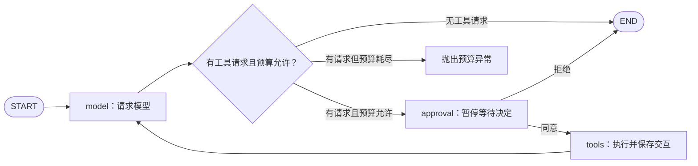

# LangGraph 第一轮学习总结

2026-11-05按[正式路线阶段9](./agent-lab总体学习路线.md#11-阶段-9langgraph)收口：完成独立图的核心机制学习与离线验证。参考补写、源码带读和测试证据不等同于脱离参考独立设计；框架机制验证也不等同于正式应用已迁移。实时进度与下一步以[第14节](./agent-lab总体学习路线.md#14-当前下一步)为准。

## 主链和原生实现的对应关系

[原生Agent](../app/services/agent.py)用循环及条件判断编排模型和工具；[独立图](../app/services/langgraph_agent.py)把携带的数据、业务步骤和选路显式表示为State、Node、Edge。模型请求与工具执行仍由应用代码完成。

不带人工确认的原独立图从预算判断直接进入tools。上图的人工确认来自[审批图](../app/services/langgraph_approval.py)，计算器用于观察执行边界，不要求普通计算都人工批准。

## 已实现与已验证

| 机制 | 项目实现与职责 | 当前证据 |
| --- | --- | --- |
| State与部分更新 | question/history保留；model_calls与additional_messages按add追加，节点只交新增项 | 顺序图验证字段保留、上游数据传递、reducer和输入不变 |
| 模型/工具节点 | call_model调用单次适配器，call_tools执行真实计算器并生成assistant/tool消息 | 直接回答一次模型请求，计算器路径两次；出站历史和工具结果检查 |
| 条件边与预算 | choose_next无工具则END，有请求且预算允许才执行工具 | 一次预算下收到工具请求后零工具尝试；与图步数上限分别计数 |
| 模型/工具失败 | 复用AgentRunError、AgentToolError及已成功调用快照 | 后续超时、非法工具参数与真实原因检查，不虚构成功结果 |
| 检查点存取 | 可选checkpointer传入compile；内存saver由调用方复用，SQLite连接在async with中管理 | 同saver重建图读回；不同任务/新内存saver隔离；SQLite重开连接还原嵌套类型 |
| 人工确认 | interrupt交出待审信息；Command(resume=bool)提供决定，条件边选执行/结束 | 暂停前零工具，重开SQLite后同意执行、拒绝结束；确认节点重入、先前模型不重跑 |
| 失败后继续 | 原文件、原thread_id，ainvoke(None, config)继续最新未完成步骤 | 后续模型超时后累计三次HTTP尝试、两条成功记录、一次工具；恢复请求消息与超时请求一致 |

基础测试位于[test_langgraph_basics.py](../tests/test_langgraph_basics.py)，图与存取/恢复测试位于[test_langgraph_agent.py](../tests/test_langgraph_agent.py)。模型HTTP预设；图、模型SDK、适配器、计算器及临时SQLite真实运行。没有为已有框架恢复能力强造新生产实现或占位RED。

收口时LangGraph相关测试11 passed（1.20秒），全量159 passed（2.11秒），diff与离线锁检查通过；失败恢复测试本地提交38527e6。模型/工具图、检查点/确认及文档历史由Git保留，本次总结随docs检查点提交，不推送。

## 三组容易混淆的边界

**任务与检查点**：一轮独立任务分配一个thread_id，任务内部及恢复沿用它；检查点在该历史中新增。新任务使用新编号。编号不能替代存储连接或权限检查。

**三种继续方式**：aget_state只读取；None继续最新未完成工作；Command(resume=...)回答动态interrupt。指定旧checkpoint_id是历史重放，其后节点会重新执行。恢复是节点重入，不保存任意Python行的执行栈。

**调用记录与尝试日志**：State中的model_calls只保存可用LLMResult，失败由异常携带；原生业务model_call表另外保存成功/失败日志。图没有自动接入该业务审计。当前预算按成功记录长度判断，不能声称它限制了跨恢复的全部HTTP尝试。

## 当前范围

- 工具声明与分发只启用计算器；State中的问题、历史、交互、调用记录和预算可复用，后续按真实数据流增加字段。
- 正式/chat、业务消息/调用/记忆表仍用原生链路；图暂停或拒绝返回原始状态，不伪装成正常AgentResult。
- SQLite验证覆盖同进程关闭并重开连接，尚未验证进程重启或执行中崩溃；历史重放已讲机制，未做专门执行测试。
- 人工确认尚无HTTP提交接口、前端或可信用户权限；预设模型响应不能证明真实模型的工具选择能力。
- 失败恢复只验后续模型超时的代表性场景，未添加自动RetryPolicy或外部写入去重。工具节点的外部动作若已完成但状态未提交，重跑可能重复，仍需业务幂等设计。

上述边界随阶段结论保留，不要求把学习图扩成生产完整系统才进入SSE；落地时按正式路线评估和验证。

## 可以怎样介绍这一阶段

在Agent-Lab中，我把原生模型/计算器循环拆成LangGraph的状态、模型节点、工具节点与条件边，保留项目结果和异常契约；接入内存及SQLite检查点，加入工具执行前人工确认，并验证同意/拒绝和后续模型超时后的显式恢复。离线测试真实运行图、SDK、SQLite和计算器，只预设模型HTTP；当前用于机制学习，尚未迁移正式聊天链路或验证生产可靠性。

## 接下来：阶段10的SSE

已完成的[模型文本流](../app/services/langchain_streaming.py)只供Python消费者逐块读取，真实流式探针也已有独立证据。下一步先讲清模型chunk、异步生成器、HTTP响应流与SSE事件的区别，再设计HTTP事件契约、逐步接线和取消/失败/最终保存边界。已有/chat不因阶段收口自动迁移框架；优秀产品及开源设计对照学习继续按正式路线保留，不从学习清单删去。
